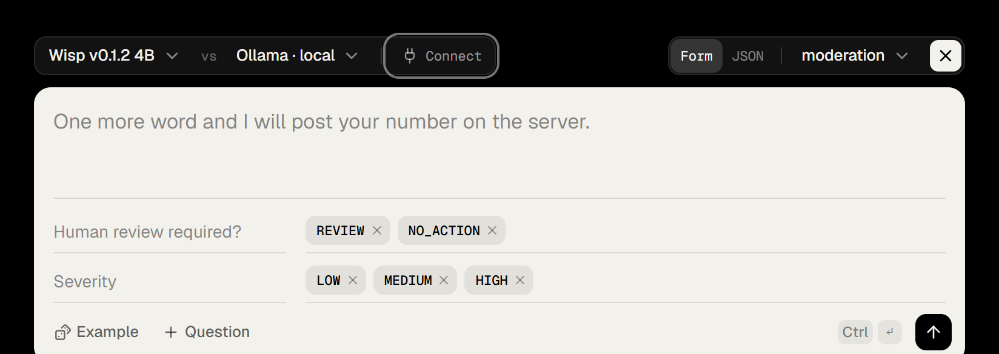
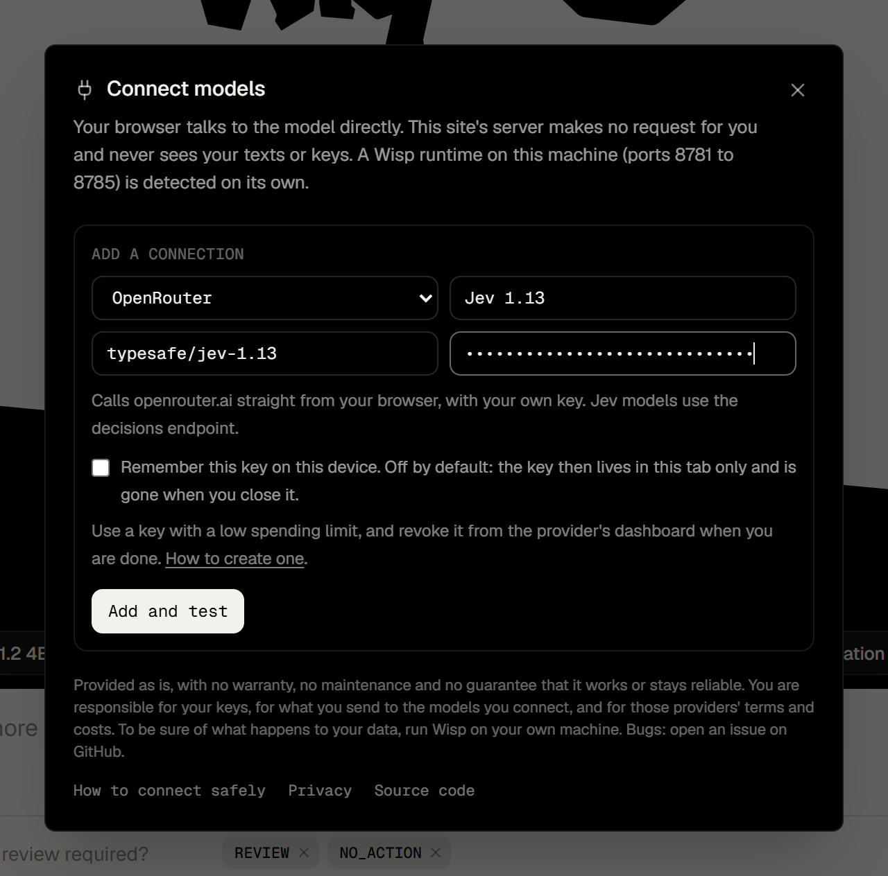
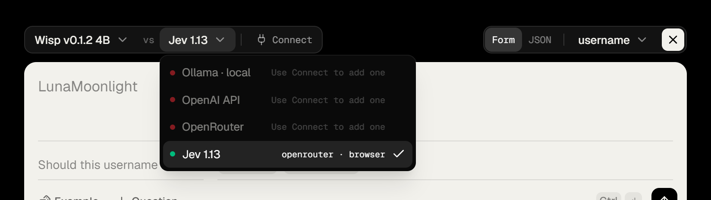

# Wisp Benchmark

[](https://github.com/notnotebox/wisp-benchmark/actions/workflows/ci.yml) [](LICENSE)

A local-first web app to compare two models or decision services on exactly the same request.

Wisp v0.1.2 is an experimental release with a trained adapter and a working local runtime. This app makes its current behavior easy to inspect alongside other models; the [Wisp repository](https://github.com/notnotebox/wisp) documents the model's results and known limitations.

It is a focused comparison workbench: put two models side by side, inspect their answers and try the supported use cases (chat moderation, report validity and usernames). The interactive view is designed for exploration; reproducible aggregate measurements remain the job of frozen benchmark runners. It is released under Apache-2.0: take it, change it and build on it (a mention of this project is appreciated).

Part of the [Wisp](https://github.com/notnotebox/wisp) project: a moderation decision model that picks one of your options with a score for each.

Compare:

- **Wisp v0.1.2 4B**, through the native Rust/Candle server (or, as a secondary option, the `wisp-decide` Python server);
- a local model served by **Ollama**;
- any endpoint compatible with the OpenAI API (LM Studio, llama.cpp, vLLM, OpenAI…);
- a remote model reached through **OpenRouter**, which also gives access to Claude (Anthropic), OpenAI and many others with one key.

See the decisions, relative scores, disagreements and human-review flags side by side. Use closed-choice classification instead of asking for a long free-text answer.

## Built with

[Next.js](https://nextjs.org), [React](https://react.dev), [Tailwind CSS](https://tailwindcss.com), [shadcn/ui](https://ui.shadcn.com) on [Base UI](https://base-ui.com), [Zod](https://zod.dev) and [CodeMirror](https://codemirror.net). The Wisp runtimes are the Rust server built on [Candle](https://github.com/huggingface/candle) (main) and [`wisp-decide`](https://huggingface.co/notebox/Wisp-v0.1.2-4B) (Python, [Transformers](https://github.com/huggingface/transformers) + [PEFT](https://github.com/huggingface/peft), secondary).

## Run a comparison

1. Pick two models in the top bar.
2. Select a preset or describe your own task.
3. Enter the content to evaluate.
4. Define one or more closed questions with their allowed options.
5. Click **Run comparison** to send exactly the same request to both models.
6. Compare decisions, scores, latency and warnings side by side.

Each question is a closed-choice classification, for example:

```json
{
  "question": "Human review required?",
  "options": ["REVIEW", "NO_ACTION", "NEED_CONTEXT"]
}
```

Do not ask the models for a free-text answer: compare how well they choose one of the options you provide.

## Interface

- **Model selectors**: choose the Wisp model and the reference model. Each entry shows whether it can answer right now (green: ready, red: not available, with the reason, for example `OLLAMA_MODEL is not set`). Unavailable entries cannot be selected.
- **Connect**: add models from your own browser (Ollama, OpenAI, Anthropic, Google Gemini, OpenRouter and any OpenAI-compatible server, with your own key). Connections stay in your browser, keys for the current tab only unless you choose to remember them, see [Privacy](src/app/privacy/page.tsx).
- **Form / JSON**: build the request visually or as JSON.
- **Preset**: load a common task (moderation, moderation + category, report validity, username).
- **Example**: fill in a sample scenario.
- **Question / Options**: add a classification question and its allowed answers.
- **Run comparison** and **Reset**.

## What runs where

| Component | Where it runs | Required |
| --- | --- | --- |
| Wisp v0.1.2 4B · Rust/Candle | Your machine, `http://127.0.0.1:8782` by default | Yes, for real Wisp inference |
| Wisp v0.1.2 4B · Python (secondary) | Your machine, `http://127.0.0.1:8781` by default | Alternative to Rust |
| Wisp Benchmark interface | Local Next.js or a hosted site | Yes |
| Ollama | Your machine (`.env.local` locally, or Connect in the browser) | Optional |
| OpenAI-compatible endpoint | A local or remote endpoint you choose | Optional |
| OpenRouter | Your own key (`.env.local` locally, or Connect in the browser) | Optional |

A hosted copy of the site is an interface, not a host for local model weights or local GPU inference. On a hosted copy, every model is reached **from the visitor's browser**: the local Wisp runtime is detected on its own, and any other model is added with **Connect**. The site's server does not receive or relay those texts, and it holds no key of its own. When you run the app locally, you can also configure providers in `.env.local`; those routes then run on your own machine.

## Paste a request (Form / JSON)

The **Form / JSON** switch shows exactly what will be sent and lets you edit or paste your own. The format, which you can copy-paste:

```json
{
  "task": "moderation",
  "text": "I will find your address and make you pay.",
  "questions": [
    { "question": "Human review required?", "options": ["REVIEW", "NO_ACTION", "NEED_CONTEXT"] },
    { "question": "Category", "options": ["INSULT", "THREAT", "HARASSMENT", "HATE", "SEXUAL", "DOXXING", "OTHER", "NONE"] }
  ]
}
```

`task` is `moderation`, `report_validity`, `username` or `null`; options have no spaces (`NO_ACTION`), 2 to 12 per question, up to 8 questions. More, and ready-to-copy `.env.local` examples for Ollama, OpenAI-compatible servers, OpenRouter and Claude, in [LOCAL-MODEL-PROVIDERS.md](LOCAL-MODEL-PROVIDERS.md).

## About the examples

The **Example** button fills in sample requests (`src/lib/examples.ts`). They are illustrative picks for trying the interface, chosen so that Wisp answers them as expected. They are **not** a measure of accuracy: for that, see the model card.

## Result modes

- **Local runtime**: real Wisp inference through the local API.
- **Reasoning**: Wisp scores the offered choices directly and generates no reasoning chain. For Ollama and OpenRouter the interface asks the provider to turn reasoning off when it supports that setting.
- **Model-reported confidence**: a connected chat provider chose a closed answer; its confidence is not a calibrated logit.
- **Unavailable**: a missing runtime or provider is an explicit error, with the reason. No fake answer is ever shown.

## Run it locally

Start a Wisp runtime. The main one is the native Rust server (Windows with CUDA) from the [Wisp repository](https://github.com/notnotebox/wisp), on port 8782:

```powershell
.\scripts\prepare_candle.ps1
.\scripts\start_candle.ps1
```

If the Rust server cannot run on your machine, the Python server is a secondary option (port 8781):

```bash
hf download notebox/Wisp-v0.1.2-4B --include "wisp-decide/*" --local-dir .
pip install "./wisp-decide[model]"
wisp-decide serve
```

Then start the interface:

```bash
pnpm install
pnpm dev
```

Open the local URL printed by Next.js. The indicator should show `Local runtime` when Wisp is detected.

## Provider configuration

```bash
cp .env.example .env.local
```

Set only the variables for the providers you use. The comparison menu chooses the provider; the concrete model comes from `OLLAMA_MODELS`, `OPENAI_COMPATIBLE_MODEL` or `OPENROUTER_MODEL`.

| Variable | Purpose |
| --- | --- |
| `NEXT_PUBLIC_WISP_LOCAL_URLS` | Wisp runtimes the browser looks for, comma separated: `http://127.0.0.1:8781` or `name=URL`. Every Wisp model found is listed with `local` (this machine), its address (another machine) or the name you give. Default: ports 8781 to 8785. Read at build time: rebuild after changing it |
| `OLLAMA_URL` | Address of the local Ollama server |
| `OLLAMA_MODELS` | Models installed in Ollama, comma separated (for example `qwen3.5:4b,qwen3.5:9b`); each is listed by name |
| `OPENAI_COMPATIBLE_URL` | URL of the `/chat/completions` endpoint |
| `OPENAI_COMPATIBLE_MODEL` | Model used by that endpoint |
| `OPENAI_COMPATIBLE_API_KEY` | Optional key for that endpoint |
| `OPENROUTER_API_KEY` | OpenRouter credential for local development. Do not set it on a public deployment: visitors would spend it |
| `OPENROUTER_MODEL` | OpenRouter model id |
| `WISP_BENCH_MODE` | Force `local` or `hosted` on the server if needed |
| `WISP_BENCH_UPDATE_CHECK` | Set to `off` to stop the hourly check of a public file on GitHub that tells whether a newer version exists |

Never put secrets in a `NEXT_PUBLIC_*` variable or commit them to Git. Examples for each provider, how to reach Claude, and where your text travels are in [LOCAL-MODEL-PROVIDERS.md](LOCAL-MODEL-PROVIDERS.md).

## Hosted deployment

Deploy the Next.js app to Vercel or any Node.js host. Set `WISP_BENCH_MODE=hosted` and **no provider key**. Visitors then connect their own models in the browser:

- a Wisp runtime on their machine is found on ports 8781 to 8785 (or the addresses in `NEXT_PUBLIC_WISP_LOCAL_URLS`);
- the **Connect** window adds Ollama, OpenAI, Anthropic, Google Gemini, OpenRouter and OpenAI-compatible servers (Mistral, LM Studio, llama.cpp, vLLM). Keys are the visitor's own, kept for the current tab only unless they tick "Remember this key on this device";
- Ollama and other local servers must allow requests from the site (for Ollama: `OLLAMA_ORIGINS=https://your-site.example`). Chrome and Edge ask for permission to reach the local network the first time; Safari and Firefox are stricter.

The site collects nothing and stores nothing on its server, makes no request on the visitor's behalf, and sends a strict Content-Security-Policy with the usual security headers (see `next.config.ts`). The `/privacy` page says so in plain words, with a no-warranty notice.

### Connect a model, step by step

The **Connect** button and the **Privacy** link are shown everywhere, locally and online; the privacy page words its text for the copy you are using. The site has a guide page (`/keys`) with the same steps and with advice on creating a key that can only spend a little for a short time (OpenRouter, OpenAI, Anthropic, Google Gemini).

1. Press **Connect**, next to the model selectors.

   

2. Pick the provider, enter the model name and your key, then **Add and test**. The key stays in the tab unless you tick the remember box.

   

3. The connection appears in the model list. Select it and run a comparison.

   

### Try the hosted mode before deploying

```bash
pnpm build
WISP_BENCH_MODE=hosted OPENROUTER_API_KEY= OLLAMA_MODELS= pnpm start -p 3000
```

On Windows PowerShell, set the variables first (`$env:WISP_BENCH_MODE="hosted"`). Then open `http://bench.localhost:3000` instead of `localhost`: the page treats any other host name as hosted, and the browser resolves `*.localhost` to your own machine.

## Before publishing

```bash
pnpm lint
pnpm build
```

## What this repository contains

This repository contains the benchmark interface and its provider adapters only. Training artifacts, datasets and evaluation panels live elsewhere and are not published.

## Contributing

Issues and pull requests are welcome, see [CONTRIBUTING.md](CONTRIBUTING.md).

## License

Apache-2.0, see [LICENSE](LICENSE).
